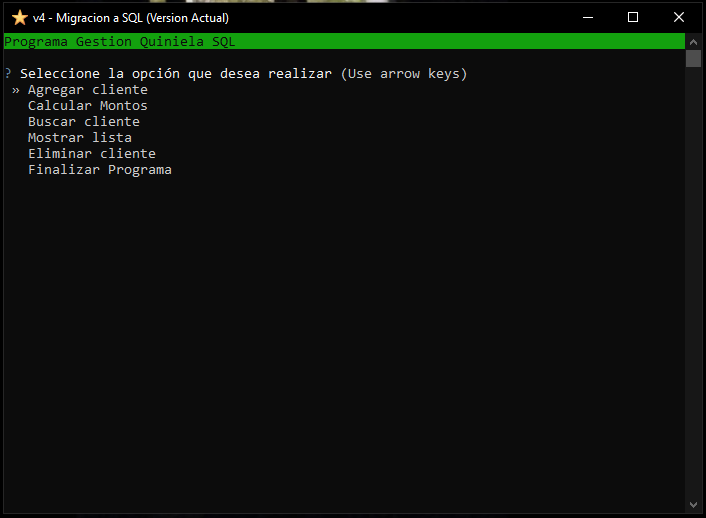

# Sistema de Gestión y Cierre de Caja (Python & SQLite)

Aplicación de consola (CLI) desarrollada en Python para la administración de clientes, registro de movimientos diarios y cierre de caja de una agencia de quiniela.

## Funcionalidades Principales
* **Gestión de Clientes (CRUD):** Alta de clientes con monto y tipo de pago, consulta de listado completo, búsqueda por nombre y eliminación de registros.
* **Clasificación de Movimientos:** Categorización de operaciones en *Efectivo, Transferencia, Fiado, Telekino* y *Egresos*.
* **Cálculo de Montos y Cierre de Caja:** Consulta de subtotales individuales por categoría o balance neto consolidado de la jornada.
* **Interfaz Interactiva:** Navegación por menús mediante flechas direccionales y alertas visuales por color según el estado de cada operación.

## Capturas de Uso

### 1. Menú Principal


### 2. Registro de Cliente y Tipo de Pago


### 3. Consulta de Listado y Cierre de Caja


## Evolución del Proyecto
Este repositorio documenta la progresión técnica del sistema desde un prototipo inicial hasta una solución con persistencia relacional:
1. **v1 - Prototipo Base:** CRUD inicial en consola con persistencia básica en archivos `.txt`.
2. **v2 - Refactorización y UX:** Limpieza de código, validaciones estrictas de entrada y navegación interactiva mediante `questionary`.
3. **v3 - Lógica de Negocio:** Incorporación de categorías de movimiento y cálculo de cierre de caja.
4. **v4 - Migración a SQL (Versión Actual):** Reemplazo de archivos planos por base de datos relacional **SQLite3**, separando la capa de acceso a datos de la interfaz de usuario.

## Aspectos Técnicos Destacados
* **Arquitectura Desacoplada:** Separación clara entre las consultas SQL y la lógica de interacción por consola.
* **Seguridad:** Uso de consultas parametrizadas (`?`) para prevenir inyección SQL.
* **Optimización en Base de Datos:** Delegación de cálculos y filtros al motor SQL mediante `SUM()`, `COALESCE()` y búsquedas insensibles a mayúsculas (`LOWER` + `LIKE`).

## Tecnologías Utilizadas
* Python 3
* SQLite3
* Questionary
* Colorama

## Tecnologías Utilizadas
* **Lenguaje:** Python 3
* **Base de Datos:** SQLite3
* **Interfaz CLI:** Questionary & Colorama

## Cómo ejecutarlo
1. Clonar el repositorio: `git clone https://github.com/MaximilianoBeron555/sistema-gestion-quiniela-sql.git`
2. Instalar dependencias: `pip install -r requirements.txt`
3. Ejecutar el programa: `python "v4 - Migración a SQL (Versión Actual).py"`

## Cómo ejecutarlo
1. Clonar el repositorio:
   ```bash
   git clone https://github.com
   cd sistema-gestion-quiniela-sql
   ```
2. Instalar dependencias:
   ```bash
   pip install -r requirements.txt
   ```
3. Ejecutar el programa:
   ```bash
   python "v4 - Migración a SQL (Versión Actual).py"
   ```
